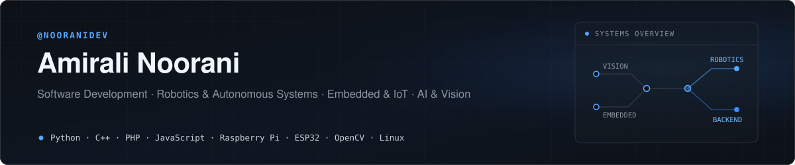

  

  Building practical software, autonomous robotics, embedded IoT architectures, computer vision pipelines, and backend systems.

---

### About Me

I am **Amirali Noorani** (`@NooraniDev`). My technical work focuses on connecting low-level hardware with computer vision, real-time communication, and backend software across **Linux** and **Raspberry Pi** environments.

---

### Areas of Interest

- **Software Development** — Modular application design, tooling, and system integration
- **Robotics & Autonomous Systems** — Perception pipelines, sensor interfacing, and autonomous navigation ([`electron-fira-autonomous-car`](https://github.com/NooraniDev/electron-fira-autonomous-car))
- **Embedded Systems** — Microcontroller firmware and hardware control on Raspberry Pi, Arduino, and ESP platforms
- **IoT & Smart Home Automation** — Distributed device communication, mesh networking, and telemetry workflows
- **Artificial Intelligence & Computer Vision** — Real-time object detection and visual processing with OpenCV and YOLO
- **Backend Development** — REST and real-time APIs, relational data modeling, and serverless edge architectures
- **Linux & Raspberry Pi** — Edge compute environments, system configuration, and deployment workflows

---

### Selected Engineering Interests

| Focus Area | Technical Scope |
| :--- | :--- |
| **Autonomous Robotics & Vision** | Camera-based perception, OpenCV image processing, YOLO object detection, and embedded actuator control |
| **IoT & Mesh Automation** | ESP32 / ESP8266 microcontroller nodes, distributed automation logic, and backend synchronization |
| **Real-Time & Edge Backends** | Python (Flask, Socket.IO), PHP, SQLite / MySQL persistence, and Cloudflare Workers edge APIs |

---

### Technical Stack

**Languages**

**Embedded & Robotics**

**AI & Computer Vision**

**Backend, Edge & Databases**

**Platforms & Tooling**

---

### Achievements & Competitions

  
  

- **2nd Place** — Iran National FIRA Robotics Competition
- **Qualified** — FIRA International Competition
- **Competitions** — Participation in robotics engineering and autonomous systems competitions ([`electron-fira-autonomous-car`](https://github.com/NooraniDev/electron-fira-autonomous-car))

---

### GitHub Statistics

  
  

  

  

---

### Contact

  
  

